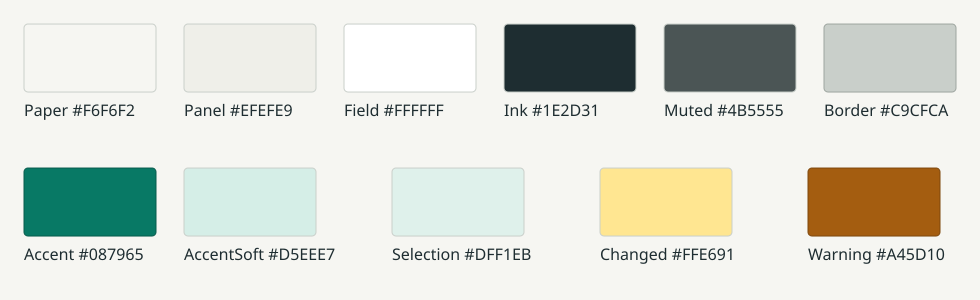

# Spectrum 128K Emulator Design Language

**Status:** Active frontend standard  
**Applies to:** Windows forms, dialogs, menus, debugger tools, and future desktop UI  
**Implementation source:** [`Forms/EmulatorUiStyle.cs`](Forms/EmulatorUiStyle.cs)

This document is the visual and interaction specification for the Windows frontend. It combines reusable design tokens with examples captured from the current application. New UI should feel like another part of the same tool, not a separately designed utility.

---

## 1. Design Principles

1. **Quiet workspace.** Warm neutral surfaces keep the Spectrum display and machine state prominent.
2. **One clear accent.** Teal identifies primary actions, active navigation, safe state, and useful links.
3. **Technical clarity.** Segoe UI explains; Consolas identifies addresses, bytes, registers, instructions, and shortcuts.
4. **Compact, not crowded.** Related information stays close without sacrificing labels, focus cues, or predictable spacing.
5. **Safe inspection.** Paused and immutable state must be explicit, especially in debugging and memory tools.
6. **Native behaviour.** Standard Windows focus, keyboard navigation, dropdown arrows, disabled states, and scrollbars are retained.

*Figure 1. The Help window is the reference for hierarchy, category navigation, section grouping, typography, and a single primary close action.*

---

## 2. Colour System

| Token | Hex | Intended use |
| --- | --- | --- |
| `Paper` | `#F6F6F2` | Form and dialog background |
| `Panel` | `#EFEFE9` | Grouped state strips and secondary surfaces |
| `Field` | `#FFFFFF` | Editable fields, lists, and secondary buttons |
| `Ink` | `#1E2D31` | Primary text and strong outlines |
| `Muted` | `#4B5555` | Descriptions, shortcuts, and secondary status |
| `Border` | `#C9CFCA` | Control and panel borders |
| `Accent` | `#087965` | Primary actions, active state, links, safe status |
| `AccentSoft` | `#D5EEE7` | Selected navigation and active flags |
| `Selection` | `#DFF1EB` | Previewed or selected safe changes |
| `Changed` | `#FFE691` | Values changed since the previous capture |
| `Warning` | `#A45D10` | Cautions and ambiguous/non-fatal state |

Use red only for errors or destructive consequences. Native blue selection may remain where Windows owns the selection rendering. Do not introduce a second brand accent.

---

## 3. Typography

### 3.1 Interface type

| Role | Typeface | Size and treatment | Example |
| --- | --- | --- | --- |
| Tool title | Segoe UI | 13 pt, bold, uppercase | `JOYSTICK CONFIGURATION` |
| Section label | Segoe UI | 8 pt, bold, uppercase | `GAME`, `NAVIGATION` |
| Body and controls | Segoe UI | 9 pt, regular | Descriptions and button labels |
| Secondary status | Segoe UI | 8-9 pt, muted or accent | `SAFE INSPECTION` |
| Machine data | Consolas | 8-10 pt as space requires | `PC 3683`, `C000 RAM 7` |

Use monospace only where fixed-width comparison or technical identity matters. Ordinary instructions, dialog titles, and button labels remain in Segoe UI.

### 3.2 Wording

- Use sentence case for controls and fields.
- Reserve uppercase for compact tool titles, section labels, and machine-state banners.
- Use specific verbs: **Save mapping**, **Apply Checked**, **Run to Cursor**.
- Explain consequences where they matter rather than exposing internal implementation names.
- Use the established terms **128K**, **48K**, **Quick State**, **Poke Manager**, **Interface II**, **mapped 64K**, and **physical RAM bank**.

---

## 4. Window Anatomy

A substantial tool window normally contains:

1. A compact title and one-line status/description.
2. Task or navigation controls.
3. One grouped content workspace.
4. A bottom status line or right-aligned action row when required.

Use `Paper` throughout rather than a contrasting masthead. Create hierarchy with spacing, typography, group boxes, and subtle `Panel` surfaces.

### 4.1 Spacing

- Outer padding: 18-24 px.
- Major vertical separation: 12-16 px.
- Related-control separation: 6-10 px.
- Standard button height: 30-34 px.
- Keep labels complete; never depend on an unexplained icon.
- Prefer grouped rows and proportional layouts over large empty areas.
- Long content must wrap or scroll rather than clip.

### 4.2 Dialog behaviour

- Centre dialogs on their owner.
- Use the existing nested pause-lease mechanism for modal inspection.
- Restore the previous emulation run state when the dialog closes.
- State **PAUSED** and **IMMUTABLE CAPTURE** whenever a tool presents frozen machine state.

---

## 5. Component Catalogue

### 5.1 Primary and secondary buttons

*Figure 2. **Save mapping** is the primary action. **Cancel** is a neutral secondary action. The same figure shows dropdowns, a slider, group boxes, descriptive copy, and a live-state panel.*

**Primary button**

- `Accent` background, white text, and `Accent` border.
- Use once per decision area for the action that completes the task.
- Examples: **Save mapping**, **Apply Checked**, **Run**, **Close** on reference-only windows.

**Secondary button**

- `Field` background, `Ink` text, and `Border` outline.
- Use for cancel, navigation, refresh, export, restore, and secondary execution commands.

**Disabled button**

- Keep the native disabled treatment.
- Do not use colour alone to explain why the action is unavailable; nearby state or help text should make the reason clear.

All styled buttons use `EmulatorUiStyle.StyleButton`. Do not locally recreate the colours and fonts.

### 5.2 Menus

*Figure 3. The context menu follows function-key order, uses separators to group related tasks, shows disabled commands in place, and places non-function-key tools last.*

- Retain native Windows menu rendering and submenu arrows.
- Put keyboard shortcuts at the start of the label where the current menu does so.
- Group state/display, transport, debugging, media, diagnostics, and optional tools with separators.
- Keep unavailable actions visible but disabled when their location is useful for learning the interface.
- Avoid deep submenu nesting; one level is the normal maximum.

### 5.3 Dropdowns and fields

- Keep native dropdown arrows and focus cues.
- Use `Field` for editable controls and selectors.
- Labels sit above or consistently to the left of related controls.
- Use human-readable values such as **Interface II - Player 1 (keys 6-0)** rather than internal enum names.
- A blank or explicit prompt such as **Choose a game...** is preferable to silently selecting an unrelated value.

### 5.4 Tabs, lists, and previews

*Figure 4. The Poke Manager combines native tabs, a labelled dropdown, task-specific lists, a preview-before-apply workflow, disabled guarded actions, and persistent status text.*

- Use tabs for distinct workflows, not for minor filters.
- Lists use `Field`; technical columns use Consolas.
- Selection alone must never apply a destructive or state-changing operation.
- Show a preview before memory edits or other consequential changes.
- Empty states should say what the user needs to do next.

### 5.5 Category navigation

- Use `AccentSoft` for the selected category and `Accent` for its key text.
- Keep all categories visible when practical.
- The right-hand content title should repeat the selected category so orientation does not depend on colour.

### 5.6 Dense technical workspaces

*Figure 5. The debugger preserves the same colours and type hierarchy while using a compact layout for navigation, execution, paging, CPU state, disassembly, references, and breakpoints.*

- Machine values and aligned columns use Consolas.
- Changed values use `Changed`; active flags use `AccentSoft`.
- Paging blocks may retain distinct listing/display-bank shades when contrast remains sufficient.
- Primary execution state is obvious without turning every command into an accent button.
- Frozen captures remain clearly labelled.

---

## 6. State and Feedback

| State | Required treatment |
| --- | --- |
| Selected navigation | `AccentSoft` background plus visible text/focus indication |
| Primary action | `Accent` background and explicit verb |
| Safe paused inspection | Accent status text containing `PAUSED` or `SAFE INSPECTION` |
| Changed machine value | `Changed` background; value remains readable without colour |
| Warning | `Warning` plus explanatory text |
| Error | Error text/message; red may reinforce but not replace wording |
| Disabled | Native disabled rendering with context explaining prerequisites |

Status text should describe the current condition or next step, not repeat a control label.

---

## 7. Accessibility and DPI

- Every action must be keyboard reachable.
- Preserve focus rectangles and logical tab order.
- Never communicate state by colour alone.
- Check text contrast and disabled-state legibility.
- Test new or materially changed forms at the active desktop DPI and minimum supported size.
- Keep controls inside their parent bounds with no clipped text.
- Add an STA interaction/layout test for important keyboard behaviour, clipping, and bounds.

---

## 8. Reference Windows

| Window | Use as the reference for |
| --- | --- |
| Help | Category navigation, concise reference content, and a reference-only primary close action |
| Joystick Configuration | Settings forms, dropdowns, slider layout, live preview, save/cancel actions |
| Poke Manager | Tabs, guarded actions, empty states, preview-before-apply workflows |
| Debugger and Disassembler | Dense technical information, machine state, execution controls, monospace data |

Choose the reference whose interaction model matches the new feature. Do not copy a layout simply because it already exists.

---

## 9. Implementation Checklist

- Apply `EmulatorUiStyle.ApplyForm` to every new frontend form.
- Use shared colour/font tokens rather than local equivalents.
- Use `StyleGroup` and the standard title, subtitle, and section-label helpers.
- Give each decision area one obvious primary action.
- Keep technical data in Consolas and explanations in Segoe UI.
- Preserve native focus, keyboard, menu, dropdown, checkbox, and scrollbar behaviour.
- Verify minimum size and active-DPI rendering.
- Add or update Windows interaction tests.
- Update screenshots and [`USER_GUIDE.md`](USER_GUIDE.md) when visible behaviour changes.

