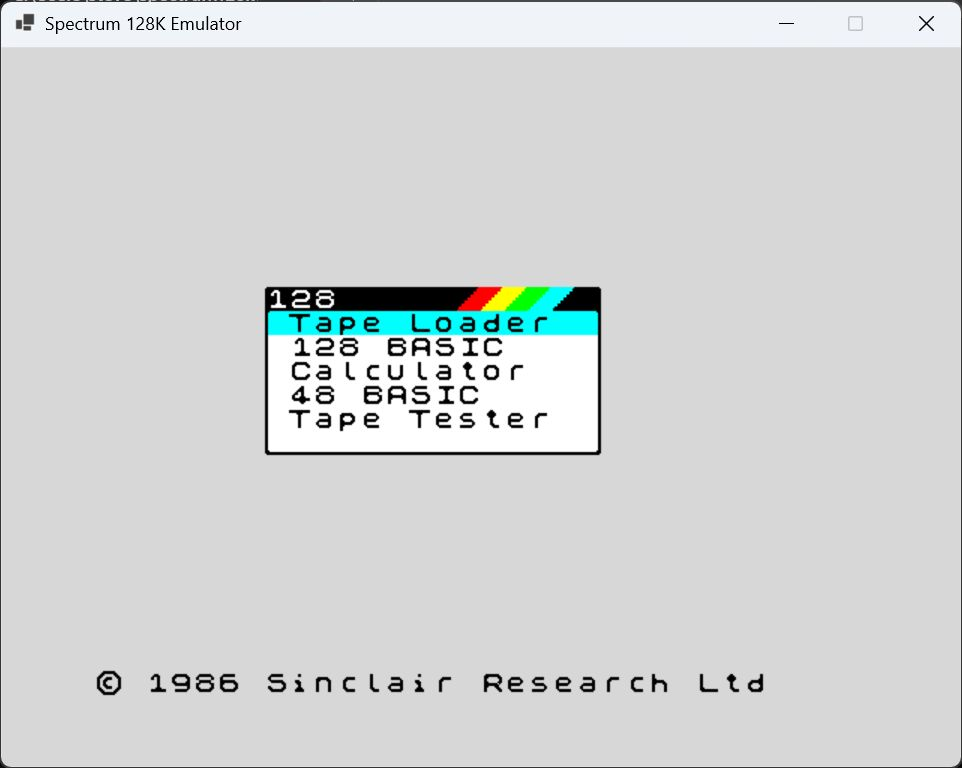
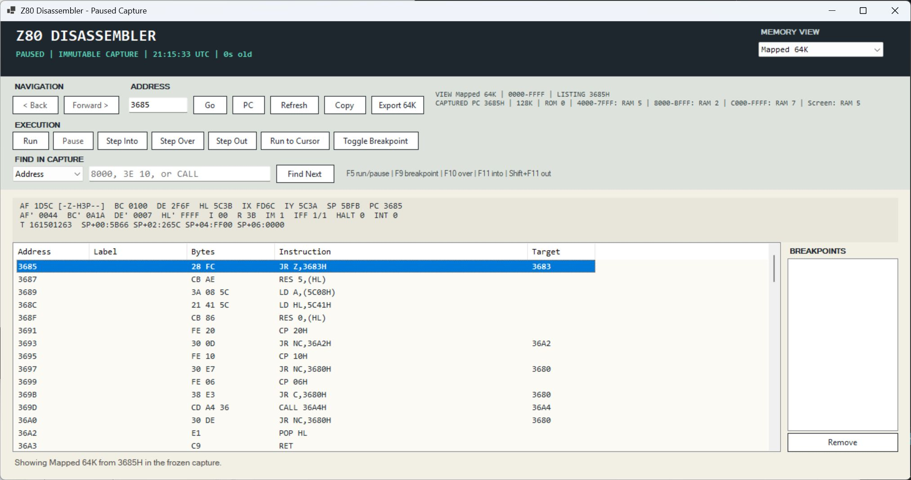

# ZX Spectrum 128K Emulator (C#)

A from-scratch ZX Spectrum 128K emulator written in C# with no third-party runtime dependencies.

This project focuses on correctness, clean architecture, and incremental development, with strong validation through automated tests and Z80 compliance tooling.

---

## Features

- Z80 CPU with passing ZEXDOC and ZEXALL instruction groups
- Explicit 48K and 128K models, 128K paging, keyboard matrix, interrupts, and a model-specific timing baseline
- Beam-latched Spectrum display with INK, PAPER, BRIGHT, FLASH, timestamped borders, and fixed 1x/Scale2x/Scale3x modes
- 48K beeper and AY-3-8912 tone, noise, envelope, and mixing through a clock-driven audio pipeline
- 48K/128K `.sna`, `.z80` v1/v2/v3, baseline `.szx`, and `.rzx` loading/replay
- `.tap` and `.tzx` parsing, fast bootstrap, ROM-driven loading, protected/mounted playback, VERIFY, and multi-block sequencing
- Manual/resumable tape transport with 48K stop-marker support and persistent status feedback
- Up to two simultaneous USB joysticks with independently selectable Kempston, Cursor, and game-facing Sinclair 1/2 mappings plus automatic or explicit controller selection and configurable raw-axis, hat, fire-button, and dead-zone mapping
- Platform-neutral headless core with Windows presentation/audio adapters
- Paused `F6` debugger with immutable mapped/physical-bank captures, a visual paging map, grouped CPU/stack context, execution controls, breakpoints, bank-qualified labels, control/data cross-references, hexadecimal memory inspection, persistent code/data markings, search, navigation, copy, and export
- In-memory `F7`/`F8` Quick State save and restore
- Paused Poke Manager with an editable validated library, checksum-aware suggestions, mapped or physical-bank one-off writes, previews, and guarded restoration
- Headless manual diagnostics and Z80 compliance runners

---

## Screenshots

### Spectrum 128K Startup



### Bank-Aware Debugger



For operation and controls, see the [User Guide](docs/USER_GUIDE.md). UI changes should follow the [Design Language](docs/DESIGN_LANGUAGE.md).

---

## Current Status

`master` is a stable, playable baseline with a headless core, clock-driven audio,
explicit machine models, resumable tape transport, a paused execution debugger,
a temporary Quick State slot, and a bank-aware Poke Manager. ZEXDOC and ZEXALL
pass in the headless compliance runner, although they are not proof that every
undocumented hardware interaction is complete.

Manually tested titles, formats, and reached checkpoints are tracked in
[Verified Games And Media](docs/VERIFIED_GAMES.md).

Current limitations and active work:

- opcode/immediate fetches, ordinary/indexed/block/stack memory accesses, port I/O, border, and floating-bus timing use model-specific machine-cycle positions validated against published 48K and 128K diagnostics
- beam-aware 48K and original 128K/+2 video is implemented and validated; broader timing-sensitive software coverage remains ongoing
- clock-driven audio and the turbo-to-real-time handoff are hardened; broader subjective title-by-title audio comparison remains ongoing
- broader protected/custom TZX compatibility remains ongoing
- Milestone 22 USB joystick support is complete, including two independently mapped host controllers, selectable Kempston/Cursor/Sinclair interfaces, and simultaneous Interface II input
- Milestone 23 SZX loading is complete for exact 48K and original 128K CPU, RAM, paging, ULA, and AY state; snapshots requiring unsupported models or peripherals are rejected

### Implementation Notes

- Fast tape bootstrap is capability-gated. Unsupported initial or chained BASIC control flow, including noncanonical line tables, protected handoff directly into raw pulses, and mixed raw-stream autorun that cannot be represented safely, falls back to a clean real-ROM autorun path with the remaining tape mounted. Proven headered CODE chains preserve their follow-on USR continuation even when the next tape signal has started. In 128K mode, unsupported standard BASIC also starts through ROM 0 and the native Tape Loader with byte-copy traps disabled, preserving the ROM's complete multi-file load sequence and bank setup. Protected chained BASIC data that depends on live ROM interpreter cursors likewise remains on exact pulse/EAR playback.
- BASIC expression syntax and header/data length consistency are preflighted before acceleration; malformed or ambiguous pairs fall back without partially executing the bootstrap. ROM-dependent malformed BASIC headers start through the native 48K `LOAD ""` command or 128K Tape Loader with byte traps disabled, preserving their intentional header side effects.
- Explicit BASIC `LOAD ... CODE address` destinations override the address advertised by the tape header in both initial bootstrap and mounted continuation stages.
- Address-based ROM tape services are enabled only for the fingerprinted bundled ROM pair; an unknown ROM pair uses real-time mounted pulse/EAR playback instead of assuming compatible internal addresses.
- ROM-driven tape handoffs preserve consumed-block pauses, exact TZX pause signal transitions, and zero-duration stop markers.
- TZX pulse and pause timings use their 3.5 MHz tape-time basis and are scaled to the selected machine clock; unstructured ROM loads return to their actual caller so banked multiload stages can continue safely.
- Standard-speed TAP/TZX pilot length follows the complete flag range: flags below `0x80`, including custom loader flags, receive the 8,063-pulse pilot; flags at or above `0x80` receive 3,223 pulses.
- TZX blocks containing a checksum-valid ROM header or header-declared data record followed by archive padding retain every physical tape byte for EAR playback while exposing only the logical ROM record to planning and byte traps.
- Mounted playback detects stable keyboard/HALT handoffs, pauses at multiload boundaries, and preserves custom ROM flag and LOAD/VERIFY state across accelerated blocks.
- Accelerated BASIC bootstrap expressions preserve `INT` and division semantics used by byte-extraction loader idioms instead of rejecting otherwise safe programs.
- Protected playback and Quick State preserve precise tape pulse, EAR, loader-continuation and replay positions.
- Continuations classified as unrepresentable remain under real ROM pulse/EAR control for the mounted remainder; byte-copy traps are disabled for that tape rather than contradicting the planner's safety decision.
- Mounted-loader continuation state, BASIC workspace preservation, resume gating, and Quick State capture are isolated from the machine in a dedicated controller.
- Tape strategy and continuation decisions do not inspect media names or game hashes; preloaded custom-loader handoff requires a unique wait loop that the executed BASIC bootstrap demonstrably patched in live RAM.
- The background emulation loop owns mutable machine state; the UI consumes copied snapshots and uses nested pause leases for safe inspection.
- Help, joystick configuration, the debugger, and the Poke Manager share one DPI-aware Windows visual system; interface chrome uses Segoe UI while machine addresses, registers, instructions, and byte values remain monospace.
- The Poke Manager pauses emulation before inspecting or changing RAM; exact media checksums are trusted matches, filename aliases are discovery hints only, and restoration is refused if the running program has since changed an applied byte.
- Windows key messages are captured before control/menu preprocessing, then applied by the emulation loop through a scan-aware matrix bridge; shared Spectrum chords retain independent host-key ownership and use emulated T-states rather than UI scheduler ticks.
- USB controllers are discovered only by the Windows adapter; up to two immutable readings become independent five-bit platform-neutral joystick states that the core exposes through Kempston or keyboard-matrix interfaces, with RZX input retaining precedence and live host state excluded from Quick State.
- The undocumented Z80 Q latch is tracked by flag-writing semantics, including prefix and interrupt boundaries, with focused regressions alongside ZEXDOC/ZEXALL.
- Maskable interrupt acceptance resets both Z80 interrupt flip-flops; `LD A,I`/`LD A,R`, `RETN`/`RETI`, and delayed `EI` behavior have focused regressions across both execution schedulers.
- Z80 IM 0 executes the interrupting device's data-bus opcode, including normal-memory operand fetches and acknowledge-cycle timing; the Spectrum defaults that bus to `0xFF` (`RST 38H`), while IM 1 retains its fixed `0x0038` vector.
- Model-specific ULA profiles now drive contention, floating-bus fetches, frame timing, and raster mapping; original 128K/+2 floating-bus reads follow the selected bank 5 or bank 7 screen, and `IN (0xFFFD)` reads the selected AY register.
- Border, beeper, and AY writes are timestamped at the completed I/O cycle, including contended and repeating block-I/O paths; border changes are reconstructed in hardware-sized eight-pixel latch groups without stretching visible pixels across horizontal flyback.
- Audio sample counts are accumulated from emulated T-states without long-run fractional drift; turbo loading suppresses host audio and discards any partially captured transition frame before resuming from the next complete frame boundary.
- Contended opcode, prefix, and immediate-byte fetches use their individual machine-cycle offsets; corrected indexed-instruction totals cover ignored `DD`/`FD` prefixes, absolute IX/IY loads and stores, stack exchange, and stack-pointer transfer.
- Interrupt scheduling carries instruction-boundary overshoot into the next frame, preserving the 69,888-T-state 48K and 70,908-T-state 128K frame cadence without truncating instructions.
- An event-driven ULA raster latches bitmap and per-scanline attribute bytes at their fetch times, including mid-frame 128K bank 5/bank 7 screen switches; each immutable completed frame owns its matching border timeline across the background-loop/UI boundary.

## Development Priorities

Each feature is developed on its own branch. Milestone 7 is complete, with
clock-driven beeper/AY generation and a tested turbo-to-real-time handoff.
Milestone 19 delivered the bank-aware debugger foundation, symbolic analysis,
conservative control/data cross-references, persistent code/data markings,
hexadecimal memory inspection, and a compact paging/CPU-state workspace.
Milestone 20 is complete, with explicit
tape-state ownership, structured load and transport diagnostics, stronger
transition tests, and behavior-preserving decomposition. Milestone 21's
bank-aware Poke Manager is complete and accepted. Its initial catalogue contains
38 exact-image definitions and 140 named pokes, including the user-verified
infinite-lives poke for the Ocean 128K RoboCop snapshot. Milestone 22 is
complete, with two independently configured USB controllers, selectable
Kempston/Cursor/Sinclair interfaces, simultaneous Interface II input, and a
platform-neutral core boundary. Milestone 23 SZX snapshot loading is complete
for supported 48K and original 128K machine state. A model-selectable 48K/128K
on-screen keyboard follows in Milestone 24. Generic Kempston and AMX mouse support follows in
Milestone 25. Tape compatibility
and broader title-specific audio fidelity validation continue in parallel, with
the verified media matrix plus ZEXDOC/ZEXALL used as regression gates.

---

## Architecture

The solution separates the platform-neutral emulator from the Windows frontend
and diagnostic tools:

```text
Spectrum128kEmulator/
|-- Spectrum128kEmulator.Core/             net8.0 platform-neutral emulator
|   |-- Audio/                             AY/beeper synthesis and sample clock
|   |-- Debugging/                         instruction-boundary execution controller
|   |-- Input/                             platform-neutral joystick state and interfaces
|   |-- Pokes/                             library validation, matching, preview, apply, and restore
|   |-- Tape/                              TAP/TZX parsing, transport, and bootstrap policy
|   |   |-- MountedTape.cs                 pulse/EAR playback state
|   |   |-- MountedTape.RomLoading.cs      ROM-load traps and byte-stream handling
|   |   |-- TapLoader.cs                   TAP orchestration and plan execution
|   |   |-- TapLoader.NativeRomBootstrap.cs  native 48K/128K ROM loader startup
|   |   |-- TapLoader.TimingAndParsing.cs  TAP parsing and pulse timing
|   |   |-- TapLoader.BasicBootstrap.cs    BASIC bootstrap analysis and execution
|   |   |-- TapLoader.BasicExpressions.cs  bootstrap expression parser
|   |   |-- TapLoader.MountedContinuation.cs  mounted-load bootstrap handoff
|   |   |-- TapeLoadPlanner.cs             capability-gated strategy selection
|   |   |-- TapeLoadContracts.cs           plans, reason codes, results, and transport state
|   |   `-- MountedLoadContinuationController.cs  ROM-profile-aware loader resume policy
|   |-- Z80/                               CPU execution plus side-effect-free instruction decoding
|   |-- Ula/                               timing profiles plus event-driven raster capture and immutable frames
|   |-- Spectrum128Machine.cs              machine orchestration, memory, paging, ULA timing, and input
|   |-- Spectrum128Machine.Diagnostics.cs  trace capture, watches, and diagnostic dumps
|   |-- SpectrumRomProfile.cs              fingerprinted ROM capabilities and internal entry points
|   |-- SpectrumFrameBuffer.cs             platform-neutral ARGB frame buffer
|   |-- BorderFrame.cs                     timestamped border events
|   |-- SnapshotLoader.cs                  SNA snapshot loading
|   |-- Z80SnapshotLoader.cs               Z80 snapshot loading
|   |-- SzxSnapshotLoader.cs               bounded SZX chunk parsing and state restoration
|   |-- RzxLoader.cs                       RZX replay loading
|   `-- RzxPlaybackSession.cs              RZX playback orchestration
|
|-- Audio/                                 Windows audio pipeline and output adapters
|-- Disassembly/                           debugger UI, bank captures, symbolic analysis, memory inspection, and export
|-- Host/                                  background loop, pause ownership, and UI snapshots
|-- Forms/                                 main window partials, shared UI styling, Poke Manager, and shortcut-reference dialog
|-- Input/                                 Windows keyboard and USB-controller adapters
|-- Pokes/                                 editable validated game/poke library and format guide
|-- Video/                                 display modes, pixel-art scaling, and presentation adapter
|-- Program.cs                             Windows application entry point
|-- Spectrum128kEmulator.csproj            net10.0 Windows frontend project
|-- docs/                                  user, design, compatibility, and engineering documentation
|   |-- USER_GUIDE.md                      current emulator operation and troubleshooting
|   |-- DESIGN_LANGUAGE.md                 Windows visual and interaction standards
|   |-- VERIFIED_GAMES.md                  manual media compatibility record
|   |-- TAPE_STATE_OWNERSHIP.md            tape subsystem ownership and invariants
|   `-- images/                            README and documentation screenshots
|
|-- Spectrum128kEmulator.Tests/            net8.0 Core unit and regression tests
|-- Spectrum128kEmulator.Windows.Tests/    Windows presentation and host tests
|-- Spectrum128kEmulator.ManualHarness/    net8.0 Core-only diagnostic and capture tool
|-- Spectrum128kEmulator.Z80Compliance/    net8.0 ZEXDOC/ZEXALL compliance runner
|-- ROMs/                                  required 128K ROM images
|-- test-assets/                           checked-in test programs and fixtures
|   |-- ula/                               external ULA diagnostic runbook (media not redistributed)
|   `-- z80/                               ZEXDOC/ZEXALL compliance programs
`-- tmp/                                   ignored local probes, captures, and scratch artifacts
```

`Spectrum128kEmulator.Core` has no WinForms, `System.Drawing`, or Windows
audio-device dependency. The `net10.0-windows` frontend consumes Core for
emulation state and produces Windows-specific video and audio output. The
compliance runner, `Spectrum128kEmulator.Tests`, and manual harness depend only
on Core. Windows presentation, debugger UI, and host behavior are covered by
`Spectrum128kEmulator.Windows.Tests`.

---

## Running

Run the emulator:

```text
dotnet run
```

ROM files must be present in the `ROMs` directory copied beside the executable
(the project does this automatically for files under its local `ROMs` folder):

```text
ROMs/
```

Expected ROMs:

- `128-0.rom`
- `128-1.rom`

The emulator starts in fixed-size `2x Enhanced` mode. `F4` cycles 1x native
(`320x240`), Scale2x (`640x480`), and Scale3x (`960x720`). Right-clicking the
display exposes the same controls in function-key order, followed by actions
that do not consume a function key.

| Key | Action |
| --- | --- |
| `F1` | Open the control reference; emulation pauses while it is open |
| `F2` | Toggle bottom-left FPS, frame, model, tape, and display diagnostics |
| `F3` | Reset and switch between explicit 128K and 48K modes |
| `F4` | Cycle fixed display size |
| `F5` | Stop or resume the mounted tape without ejecting it |
| `F6` | Open the debugger and disassembler, paused on an immutable machine capture |
| `F7` / `F8` | Save or restore the temporary in-memory Quick State |
| `F9` | Load a 48K or 128K `.sna` snapshot |
| `F10` | Load a `.z80` or `.szx` snapshot, or play an `.rzx` recording |
| `F11` | Mount a `.tap` or `.tzx` tape image |
| `Shift+F11` | Replace the mounted tape without resetting the running machine |
| `F12` | Write a machine diagnostic dump |

The right-click `Joystick` submenu contains separate Controller 1 and Controller
2 status/selection menus plus `Configure both controllers...`. Each controller
can be disabled, assigned automatically to the first unclaimed USB device, or
pinned to a named device. The configuration dialog pauses emulation while each
channel is mapped independently to Kempston, Cursor, Sinclair 1 (keys 1-5;
Interface II socket 2), or Sinclair 2 (keys 6-0; Interface II socket 1), with
named axes, an optional D-pad/hat, an optional fire button, and an axis dead
zone. Live previews confirm both mappings before they are saved. The default
mapping uses axes 0/1, hat 0, button 0, and a 25% dead zone; settings persist per
Windows user. A named device is never silently substituted, automatic channels
claim distinct devices, and unavailable input becomes neutral. Duplicate host
device or Spectrum-interface assignments are rejected when both channels are
enabled.

The right-click menu also opens the Poke Manager. Emulation remains paused while
it is open. Its Library tab reads the user-maintainable `Pokes/pokes.json` file;
exact SHA-256 matches are authoritative, while filename aliases are visibly
labelled as suggestions only. Unmatched media stays on `Choose a game...` rather
than selecting an unrelated title. The catalogue contains 38 exact-image game
definitions and 140 named pokes; RoboCop is gameplay-verified, while the other
source-backed entries have checksum and target-layout validation pending
progressive gameplay confirmation. The One-off tab supports mapped RAM or an
explicit physical RAM bank, previews current and replacement bytes, and can
restore the most recent session poke when the game has not changed those bytes.

Tape changes show a top-left badge: full text for three seconds, then a compact
playing icon; paused/auto-stopped icons hide after five seconds. The title bar
shows the current media name, while transport state remains in the temporary
overlay and optional `F2` diagnostics. The temporary Quick State slot restores
the associated media name as well as CPU, RAM banks, paging, ULA/audio frame
state, tape, and RZX position; it survives media loads during the session and is
discarded on exit.

The debugger captures the mapped logical 64K, both ROM banks, all eight RAM
banks, registers, flags, interrupt state, stack context, model, and paging state.
Its grouped CPU panel highlights values changed since the previous stopped
capture, shows the instruction at `PC`, and retains the main and alternate
registers, individual flags, interrupt state, timing, and four stack words.
Register addresses open in Memory, while the PC and stack values navigate the
disassembly listing. The visual paging map identifies the current ROM, all three
mapped RAM slots, and the active display bank; its compact fallback preserves the
same context at narrow window widths. The memory-view selector keeps mapped
addresses distinct from bank-qualified physical offsets; search, history, copy,
and export follow the selected view.
Bank-qualified labels persist between sessions, can be imported or exported as
plain-text symbol files, and are created automatically when an unlabeled direct
call or branch target is followed.
Direct calls and jumps plus absolute Z80 data reads/writes produce incoming and
outgoing cross-references without interpreting arbitrary data as executable code.
The independent Memory tab displays mapped or physical-bank bytes in hexadecimal
and ASCII, and can navigate from registers, stack values, listing addresses, and
direct control/data targets without changing the disassembly view.
Media- and model-scoped bank-qualified code/data ranges also persist as debugger
metadata without modifying captured machine memory. Confirmed data is displayed
and exported as `DB`, excluded from mnemonic decoding and recursive control-flow
analysis, while confirmed code supplies additional analysis entry points.
It opens paused and supports Run/Pause, Step Into, Step Over, Step Out, run to
cursor, and persistent enabled/disabled mapped-address breakpoints. The listing
remains frozen while execution runs and refreshes only after the machine stops
safely at an instruction boundary. Help and file choosers use nested-safe pause
ownership.

---

## Tests

Run all tests:

```text
dotnet test
```

Test coverage includes:

- CPU instruction behaviour
- Memory paging
- Keyboard matrix
- FLASH timing
- Renderer correctness
- ROM boot smoke tests
- Focused opcode regression tests
- Snapshot loading
- Poke-library schema, checksum/alias matching, mapped and physical-bank application, guarded restoration, and STA WinForms interaction
- Tape parsing
- TZX parsing
- RZX replay parsing
- VERIFY handling
- Tape sequencing and reset behaviour
- banked tape-loader regression coverage
- Tape transport pause/resume and 48K stop-marker behaviour
- 48K/128K machine-model behavior
- complete 48K/128K contention phases, boundaries, I/O cases, and contended-bank behavior
- 48K/128K floating-bus fetches, including 128K shadow-screen bank selection
- exact port event timestamps, block-I/O timing, and border latch/raster mapping
- timed opcode, prefix, immediate, ordinary, indexed, block, stack, interrupt-vector, and IM 0 data-bus instruction cycles
- AY register write and selected-register port-read behaviour
- Audio sample generation, long-run 48K/128K sample-clock drift, and clipping diagnostics
- Audio pipeline behaviour, including turbo suppression, clean frame-boundary resume, and Quick State transition restoration
- Z80 instruction decoding, bank-aware disassembly navigation/search, paging-map presentation, grouped CPU-state changes and address links, labels, classifications, control/data cross-references, hexadecimal memory inspection, listing export, settings, snapshot behavior, and STA WinForms interaction
- Quick State deterministic machine, tape-cursor, and RZX-cursor restoration
- ZEXDOC and ZEXALL compliance validation via the dedicated runner

ZEXDOC and ZEXALL are used separately for full CPU validation.

---

## Snapshot Support

Current snapshot status:

- `.sna`
  - 48K file-format loading implemented and verified
  - 48K-format snapshots can run on the selected 48K or 128K hardware model
  - 128K file-format loading restores all RAM banks, paging state, and the explicit program counter
  - standard and duplicate-current-page 128K layouts are supported; TR-DOS snapshots are rejected because no TR-DOS ROM is emulated
  - a converted 128K Renegade snapshot has passed exact representable-state round-trip comparison and an execution smoke test
  - interrupt state restored from snapshot header semantics
  - generic format-based load path in use

- `.z80`
  - v1 loading implemented
  - v2/v3 page-block support implemented
  - 128K paging and RAM-bank restoration supported for applicable v2/v3 snapshots
  - interrupt state and interrupt mode restored from snapshot metadata
  - 48K-layout v1/v2/v3 snapshots can run on the selected 48K or 128K hardware model

- `.szx`
  - SZX 1.x loading implemented for exact 48K and original 128K machine IDs
  - restores CPU registers and execution state, RAM, frame phase, ULA state, 128K paging, and AY registers
  - accepts compressed or uncompressed RAM pages, arbitrary chunk order, and unknown optional metadata
  - validates the complete snapshot before changing the machine
  - rejects unsupported machine models, alternate timing, Issue 2 behavior, external 48K AY state, and known unsupported peripheral blocks rather than approximating them
  - an independently generated libspectrum SZX 1.3 48K fixture passes load and execution smoke validation

Snapshots can be loaded with `F9` (`.sna`) and `F10` (`.z80` or `.szx`) in the UI.

---

## Manual Harness

A simple headless harness is included for debugging:

```text
dotnet run --project Spectrum128kEmulator.ManualHarness
```

This runs the emulator without UI and logs state.

Its generic diagnostics accept `frames=`, `model=48|128`, `quiet=1`, `audioanalysis=1`, `dumpblocks=1`, `strategy=`,
scheduled key/register/memory/tape-replacement events, memory-write watches, instruction traces, and
execution breakpoints. It writes a machine dump and BMP frame image only for the run being
investigated; audio analysis reports generated frame/sample counts, nonzero samples,
peak, RMS, clipping, and maximum adjacent-sample delta. Game-specific probes are
deliberately kept out of the harness.

The [ULA timing validation runbook](test-assets/ula/README.md) records how the
48K/128K Timing Test and floating-bus diagnostics are run without redistributing
their GPL-licensed media.

> Intended for debugging, not performance measurement.

---

## Z80 Compliance Runner

A dedicated headless runner is included for CPU validation:

```text
dotnet run -c Release --project Spectrum128kEmulator.Z80Compliance -- test-assets/z80/zexdoc.com 7000000000
```

Notes:

- Runs ZEXDOC and ZEXALL in a minimal CP/M-style environment
- Fully uncapped execution
- Used for correctness validation, not timing accuracy
- All instruction groups currently pass

---

## Roadmap

Milestone numbers record delivery order. Milestone 6 stays open for wider tape
compatibility; completed milestones remain regression baselines.

| Milestone | Status | Outcome |
| --- | --- | --- |
| 1 | Complete | Active-low keyboard matrix, scan-aware Windows input, shared chord ownership, 128K menu navigation, and BASIC entry |
| 2 | Complete | Attribute/FLASH rendering and renderer optimization |
| 3 | Complete | 50Hz pacing, frame execution, and interrupt cadence |
| 4 | Complete | ZEXDOC/ZEXALL CPU baseline, hardware-derived block-I/O flags, Q-latch and interrupt semantics, and general IM 0 bus-instruction execution |
| 5 | Complete | 48K/128K `.sna` plus `.z80` v1/v2/v3 support |
| 6 | In progress | Structure-driven TAP/TZX bootstrap, ROM, protected, mounted, VERIFY, and sequencing paths |
| 7 | Complete | Clock-driven beeper/AY synthesis, mixing, and clean turbo-to-real-time audio handoff |
| 8 | Complete | Headless core/UI split and clock-driven audio buffering |
| 9 | Complete | Initial ULA contention, floating-bus, and timestamped border baseline |
| 10 | Complete | Side-effect-free Z80 decoder foundation |
| 11 | Complete | Explicit resettable 48K/128K machine modes |
| 12 | Complete | Resumable tape transport and TZX 48K stop markers |
| 13 | Complete | Paused read-only mapped-64K disassembler window |
| 14 | Complete | Deterministic temporary in-memory Quick State |
| 15 | Complete | Disassembler history, search, navigation, persistence, copy, and export |
| 16 | Complete | Central ULA profiles, contention conformance, 128K floating bus, exact port events, border-latch mapping, timed CPU bus cycles, and published diagnostic validation |
| 17 | Complete | Event-driven beam capture for bitmap, per-line attributes, border timing, and 128K shadow-screen changes, validated against Arkanoid and published diagnostics |
| 18 | Complete | Instruction-boundary Run/Pause, Step Into/Over/Out, run to cursor, CPU context, and persistent breakpoints |
| 19 | Complete | Bank-aware inspection, labels, conservative control/data cross-references, persistent code/data marking, and hexadecimal memory navigation |
| 20 | Complete | Tape state ownership, transition coverage, structured diagnostics, and behavior-preserving subsystem decomposition |
| 21 | Complete | Accepted bank-aware Poke Manager with one-off writes, guarded restore, and an initial 38-game checksum-scoped catalogue |
| 22 | Complete | Two-channel USB joystick input with selectable Kempston, Cursor, and Interface II mappings through a Windows-only host adapter and platform-neutral core state |
| 23 | Complete | Bounded SZX loading for supported 48K and original 128K machine state, with explicit rejection of unsupported models and peripherals |
| 24 | Planned | Pop-up on-screen keyboard with selectable authentic 48K and 128K layouts |
| 25 | Planned | Host mouse capture through generic Kempston Mouse support followed by interrupt-driven AMX Mouse emulation |

### Milestone 7 - Audio And Turbo Handoff Complete
- Generates 48K beeper and 128K AY tone, noise, and envelope output from timestamped machine events through one mixed sample pipeline
- Uses a fractional T-state sample clock with no cumulative sample drift across tested ten-minute 48K and 128K runs
- Keeps AY oscillator, noise, envelope, and mixer state continuous across emulated frames and Quick State restoration
- Suppresses host audio during accelerated tape execution and resumes only from a fully captured frame, discarding the incomplete transition frame rather than synthesizing missing history
- Preserves the transition-frame validity state in Quick State so restoration cannot reintroduce a partial audio frame
- Adds headless amplitude, RMS, clipping, and discontinuity diagnostics plus focused transition and explicit snapshot-model regressions
- Confirms active, unclipped output across Exolon `.sna`/`.z80`, Target Renegade `.sna`/`.z80`, Cybernoid `.z80`, and 48K tape playback; Arkanoid gameplay timing and sound behavior also match JSspeccy closely, with only a slightly cooler timbre observed

### Milestone 16 - ULA Timing Conformance And Port Accuracy Complete
- Implemented one model-specific timing profile for frame length, scanline length, contention start, display fetches, visible raster mapping, and the documented timing convention
- Added table-driven contention coverage across complete 48K and original 128K display phases, line/frame boundaries, contended memory banks, and all four I/O contention cases
- Timestamped opcode/immediate fetches, ordinary/indexed/block/stack memory accesses, interrupt-vector reads, and port reads/writes at their machine-cycle positions, including contended I/O and the distinct block-I/O repeat tail
- Generalized the floating-bus model for the original Spectrum 128K and grey +2, including normal bank 5 and shadow bank 7 screen selection
- Decoded attached input devices before the floating-bus fallback, including `IN (0xFFFD)` reading the selected AY register
- Corrected and tested border, beeper, and AY write timestamps plus eight-pixel border-latch and visible pixel/T-state mapping without claiming +2A/+3 behavior
- Preserved interrupt phase across instruction-boundary overshoot, producing exact published frame lengths of 69,888 T-states for 48K and 70,908 T-states for 128K
- Matched the Patrik Rak Timing Test 0.3 reference captures pixel-for-pixel for 48K/128K contended NOP, snow-effect NOP, and all six even/odd I/O contention cases
- Matched the Mark Woodmass Float48K and Float128K reference address/value sequences, with the repeatable external-media procedure recorded under `test-assets/ula`

### Milestone 17 - Beam-Aware Video Pipeline Complete
- Implemented an event-driven ULA raster that advances to timed machine events without requiring a literal per-T-state host loop
- Bitmap bytes and attributes are latched at their individual ULA fetches; attributes are fetched independently on every pixel line rather than read from final frame RAM
- Original 128K/+2 bank 5 and shadow bank 7 screen changes take effect at their timed paging event, so one frame can contain output from both banks
- Completed raster frames own their matching timestamped border timeline, remain immutable across the background-loop/UI boundary, and survive Quick State capture and restore
- Preserved FLASH, palette, display scaling, and the platform-neutral frame-buffer boundary
- Added deterministic fetch-boundary, per-line attribute, shadow-screen, border ownership, rendering, and no-screen-write frame tests; published 48K/128K contention captures remain pixel-identical
- Eliminated the previously observed Arkanoid ship flicker while preserving CD Player and Cybernoid snapshot rendering and protected tape execution

### Milestone 18 - Debug Execution Controls Complete
- Opens paused by default, with explicit Run/Pause controls and a visibly frozen capture while execution is active
- Implements Step Into, call-aware Step Over, stack-aware Step Out, and Run to Cursor at instruction boundaries
- Provides persistent enabled/disabled address breakpoints with a compact list and listing highlights
- Shows a compact grouped CPU panel with main and alternate registers, individual flags, interrupt state, stack context, timing, the instruction at `PC`, changed-value highlighting, and direct register/stack navigation
- Keeps execution and breakpoint policy in a platform-neutral debugger service, with deterministic controller, interrupt-boundary, CPU, and scheduler tests
- Refreshes the immutable capture only after a safe stop, avoiding mutable-state inspection while execution is active

### Milestone 19 - Bank-Aware Disassembly And Symbolic Analysis Complete
- Completed immutable inspection of both ROM banks and all eight RAM banks independently of the currently mapped 64K address space
- Completed explicit mapped versus bank-qualified offset context across navigation history, search, copy, and 64K/16K export
- Completed persistent user labels, automatic followed-target labels, symbol-aware navigation, and bank-qualified symbol import/export
- Completed refreshed paging context without conflating physical offsets with logical CPU addresses
- Completed a responsive four-slot paging map for the current ROM, mapped RAM banks, active display bank, listing address, captured PC, and machine model
- Completed stable bank-qualified listings suitable for diagnostics and comparison between emulator runs
- Completed incoming and outgoing direct control-flow cross-references for calls and jumps, with recursive analysis limited to explicit code roots and conservative bank qualification
- Completed and acceptance-tested persistent bank-qualified code/data/unknown range marking; confirmed data renders as `DB` and is excluded from mnemonic search and recursive control-flow decoding
- Completed conservative absolute-address data read/write cross-references, including byte/word widths and bank qualification, without treating indirect accesses or arbitrary data as executable code
- Completed an independent hexadecimal/ASCII memory inspector with mapped and physical-bank views plus navigation from registers, stack entries, listing addresses, and direct control/data targets

### Milestone 20 - Tape Architecture Hardening Complete
- Documented current tape-state ownership and invariants across transport, load-strategy selection, continuation handling, threading, and Quick State restoration in [Tape State Ownership](docs/TAPE_STATE_OWNERSHIP.md)
- Added focused machine-level lifecycle coverage for no-tape behavior, media replacement, eject, model reset, and stopped/ended Quick State restoration
- Added explicit `Shift+F11` tape-side replacement that preserves the running CPU, RAM, paging, and machine model while mounting the next TAP/TZX side; the right-click menu exposes the same guarded action
- Isolated tape read, loader-activity, handoff, and automatic-resume counters plus their Quick State in a dedicated activity tracker without changing transition policy
- Centralized mounted-media identity, transport state, lifecycle transitions, and exact transport Quick State restoration in a dedicated controller
- Moved automatic handoff stop/resume decisions behind the activity tracker and added direct coverage for all safety gates plus exact EAR-phase preservation
- Extracted capability-gated load-strategy selection into a dedicated planner while leaving plan execution and loader continuation behavior unchanged
- Added structured transport transition reasons for reset, mount, manual stop/resume, automatic handoff stop/ROM resume, stop markers, tape end, and eject; the reason is preserved by Quick State and included in diagnostics
- Extended activity-based handoff detection to keyboard loops that discard EAR with either `AND` or `OR`; qualifying polls may span intervening music/animation frames, while any genuine EAR read cancels the pending stop
- Locked the recent compatibility fixes behind synthetic regressions for early-stop prevention, cross-frame keyboard evidence, EAR-sensitive cancellation, exact-cursor ROM resume, `INT`/division tokenization, and bootstrap byte-extraction expressions
- Added a protected chained-BASIC capability gate so blocks that read live ROM interpreter cursors remain on exact pulse/EAR playback instead of entering the byte-copy trap
- Routed noncanonical BASIC line tables, including duplicate or malformed line records used by protected loaders, through native ROM loading instead of the accelerated bootstrap interpreter
- Routed unsupported standard BASIC through the native 128 Tape Loader with per-mount ROM traps disabled; exact pulse/EAR playback now carries multi-file 128K loaders through their real ROM control flow without changing accelerated tapes globally
- Recognized checksum-valid ROM record prefixes inside padded TZX blocks while preserving the trailing physical bytes, allowing two-stage BASIC prefixes to enter their protected continuation without weakening malformed-record checks
- Disabled byte-copy traps for mounted continuations the planner cannot represent safely, preserving application-RAM ROM-call returns and loader state through exact pulse/EAR execution
- Re-ran every entry in the verified-media matrix with post-load execution soak; Target Renegade 48K/128K, New Zealand Story, Indiana Jones, and Oracle's Cave also passed their mode-specific or interactive multiload checkpoints
- Added table-driven lifecycle coverage alongside focused regressions for fast loading, real-time fallback, pause/resume, stop markers, tape end, multiloads, media replacement, reset, and Quick State restoration
- Split the large tape regression suite into transport, mounted-playback, and load-planning test files without reducing coverage
- Kept pulse/EAR transport, fast/ROM/protected load strategy, and BASIC/machine-code continuation as separate cooperating responsibilities rather than one combined state machine
- Reduced the three largest tape implementation files through behavior-preserving partial-class extractions for parsing/timing, ROM loading, BASIC expressions, and mounted continuation; `MountedLoadContinuationController` remains focused on resume state
- Added stable load-plan reason codes for unsupported acceleration, inconsistent BASIC header/data pairs, unsafe standard or mixed-stream bootstrap control flow, and unrepresentable continuation while retaining readable explanations and distinct transport reasons for pause, tape end, and ROM handoff
- Removed the application-RAM continuation whitelist and replaced arbitrary custom-loader byte matching with a unique BASIC-patched wait-loop transition, guarded against unchanged lookalikes
- Retained the full automated suite, ZEXDOC/ZEXALL, and the verified media matrix as regression gates throughout the structural work
- Completed final interactive acceptance with the hardened tape paths and transport behavior confirmed working as expected

### Milestone 21 - Poke Manager And Cheat Library Complete
- Added a discoverable Poke Manager through the right-click context menu without consuming another function key; emulation remains paused while it is open
- Added a versioned, validated, human-maintainable `Pokes/pokes.json` library for game titles, aliases, model requirements, exact media checksums, named multi-address pokes, and mapped or bank-qualified writes
- Added model-aware library browsing with exact SHA-256 matches clearly distinguished from filename-only discovery suggestions
- Added one-off mapped-64K and physical-bank writes with explicit address context, hexadecimal or decimal input validation, duplicate-target rejection, and a current/new byte preview
- Applies a selected set atomically while the emulation loop is paused and keeps a session-local restoration stack; restoration is refused if the program has since changed an applied byte
- Keeps the first version to deliberate one-time writes; frozen values, conditional trainers, and cheat discovery remain deferred until their continuous-mutation semantics are designed and tested
- Added schema, duplicate-entry, checksum/alias matching, bank-selection, model-safety, application, restoration, empty-library, layout, and frontend workflow tests
- Added an initial catalogue of 38 exact-image game definitions and 140 named pokes from published reference data, rejecting candidates whose local snapshots did not match the expected memory layout
- Kept the user-verified RoboCop infinite-lives entry distinct from source-backed entries awaiting progressive gameplay confirmation
- Completed visual QA at the active desktop DPI, exact-match acceptance, and full regression coverage; expanding the version-verified catalogue remains ongoing data work rather than a blocker for the feature

### Milestone 22 - USB Joystick Input Complete
- Keeps host input platform-neutral: the core owns only independent Right, Left, Down, Up, and Fire states plus their selected Spectrum interfaces
- Supports Kempston through active-high low port byte `0x1F`, Cursor through keys 5/8/6/7/0, Sinclair 1 through keys 1-5, and Sinclair 2 through keys 6-0 without synthesizing host key events; the UI also identifies the historically opposite Interface II socket numbers
- Combines Sinclair joystick and physical keyboard contributions independently so releasing either input source cannot incorrectly release the other
- Discovers and polls USB game controllers through a Windows-only `Windows.Gaming.Input` adapter, with no Windows controller types crossing into the core
- Routes immutable controller readings through the emulation-loop input boundary, clears state safely on reset or disconnection, and preserves recorded RZX port input precedence
- Provides two independently enabled channels with automatic unclaimed-device selection, explicit device pinning, nested status menus, and a polished dual live-preview dialog without consuming a function key
- Rejects duplicate USB-device and emulated-interface assignments while allowing the original Interface II's two joystick sockets to operate simultaneously
- Migrates single-controller settings into Controller 1 without changing their numeric interface values; Controller 2 defaults to disabled
- Covers 48K/128K port behavior, timed reads, simultaneous Cursor/Interface II matrix contributions, mixed keyboard ownership, two-device polling, mapping, configuration round-tripping, disconnect cleanup, persistence, menu state, and thread ownership with hardware-independent tests; the configuration flow and single attached controller have also passed live Windows acceptance

### Milestone 23 - SZX Snapshot Support Complete
- Added a dedicated SZX 1.x chunk parser with strict bounds checking, complete pre-apply validation, and clear malformed-file diagnostics
- Restores supported 48K and original 128K CPU registers and execution state, RAM, paging, frame phase, ULA state, and AY state through existing machine boundaries
- Accepts compressed and uncompressed RAM pages, arbitrary chunk order, and safely optional unknown metadata while rejecting unsupported machines, timing variants, and known peripheral state
- Integrated `.szx` with the shared F10 picker, media-title handling, reset lifecycle, audio/input cleanup, manual harness, and existing machine ownership rules
- Added synthetic chunk-order, unknown-chunk, truncation, compression, duplicate/missing-state, paging, interrupt-pulse, unsupported-model/peripheral, and 48K/128K execution smoke tests; an upstream libspectrum SZX 1.3 48K fixture also passes load and execution validation

### Milestone 24 - On-Screen Keyboard Planned
- Add a discoverable non-modal pop-up keyboard through the normal menus and right-click context menu without consuming another function key
- Provide selectable 48K rubber-key and 128K keyboard layouts with authentic legends and model-appropriate key placement
- Route pointer presses through the existing scan-aware Spectrum keyboard bridge so physical and on-screen input share matrix, chord, ownership, and emulated-timing behavior
- Support held keys, reliable release on pointer loss or window close, and Spectrum chord keys such as symbol-shift combinations without leaving matrix keys stuck
- Keep the keyboard usable alongside the emulator at common desktop sizes, remember its position and selected layout, and avoid covering or resizing the emulated display
- Add matrix-mapping, multi-key chord, hold/release lifecycle, model-switch, focus-loss, and frontend interaction tests

### Milestone 25 - Kempston And AMX Mouse Support Planned
- Add explicit host-pointer capture only when requested, with click-to-capture, `Esc` release, focus-loss cleanup, and a clear on-screen capture indicator
- Keep host pointer movement and buttons in the Windows adapter while the platform-neutral core owns emulated peripheral counters, buttons, ports, and interrupt state
- Implement Kempston Mouse first through its wrapping X/Y counters and active-low button port, without conflating it with the existing Kempston joystick interface
- Add AMX Mouse as a separate second phase with Z80 PIO data/control ports, movement-driven interrupts, button input, and tested interaction with normal Spectrum interrupts
- Model real peripheral conflicts explicitly, including the AMX use of port `0x1F`, rather than allowing incompatible joystick and mouse interfaces to respond simultaneously
- Preserve emulated mouse counters and peripheral state in Quick State and supported SZX snapshots while excluding transient host capture state
- Add port-decoding, counter-wrap, scaling, button, capture/release, focus-loss, interrupt-ordering, save/restore, and peripheral-conflict tests plus acceptance checks with The Artist II

---

## Longer-Term Improvements

- Demo compatibility beyond the current validation matrix
- Broader real-game validation
- Selectable presentation palettes: an authentic CRT/composite-inspired default and the existing idealised `D7/FF` digital palette, without changing emulated colour attributes or saved state
- Optional game library window with searchable artwork tiles, recent items, and an explicit file picker; prefer a scalable grid over a carousel-only interface
- Additional platform frontends, including a browser/WebAssembly adapter using the established headless engine boundary

---

## Design Principles

- No third-party runtime dependencies; xUnit and its runner are test-only packages
- Incremental development (no large rewrites)
- Behaviour verified with tests, ZEXDOC, and ZEXALL
- Clear separation between emulation and UI, with platform-neutral video and audio contracts
- Headless tooling for reproducible debugging

---

## Contributing

This is primarily a personal project for learning and development.

Contributions are welcome for bug fixes with tests. Feature changes should
align with the roadmap and be discussed before implementation.

See `CONTRIBUTING.md` for details.

---

## License

MIT
