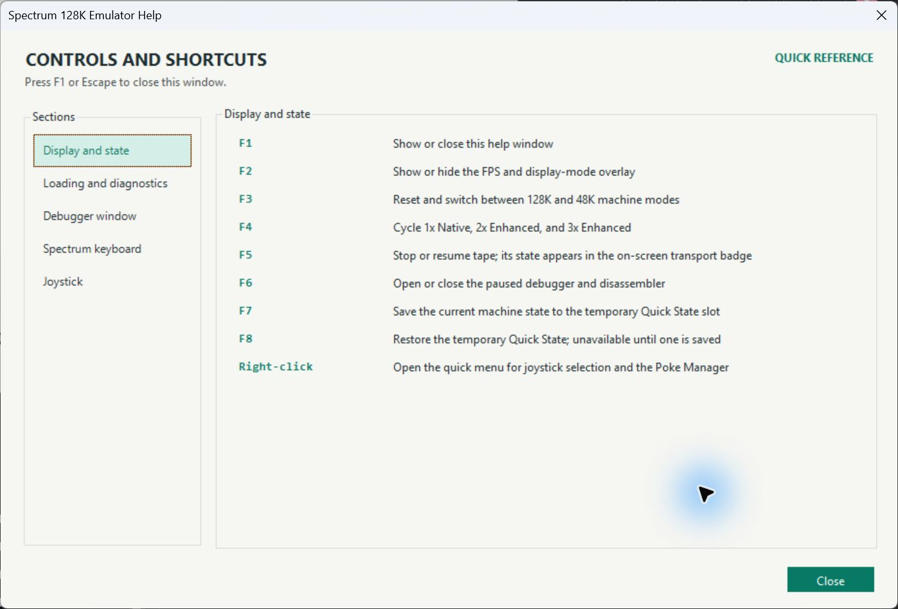
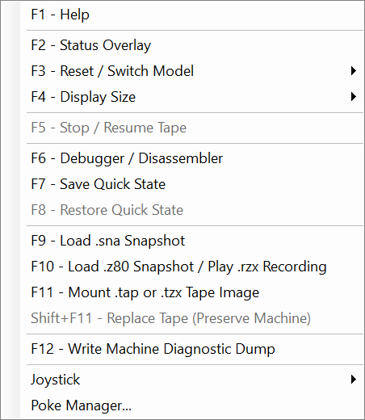
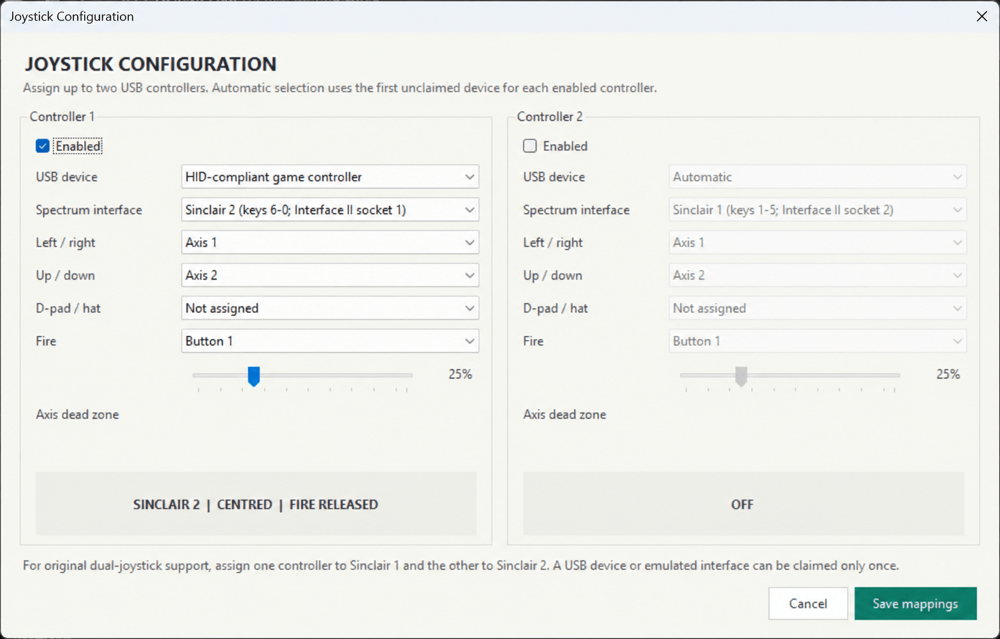
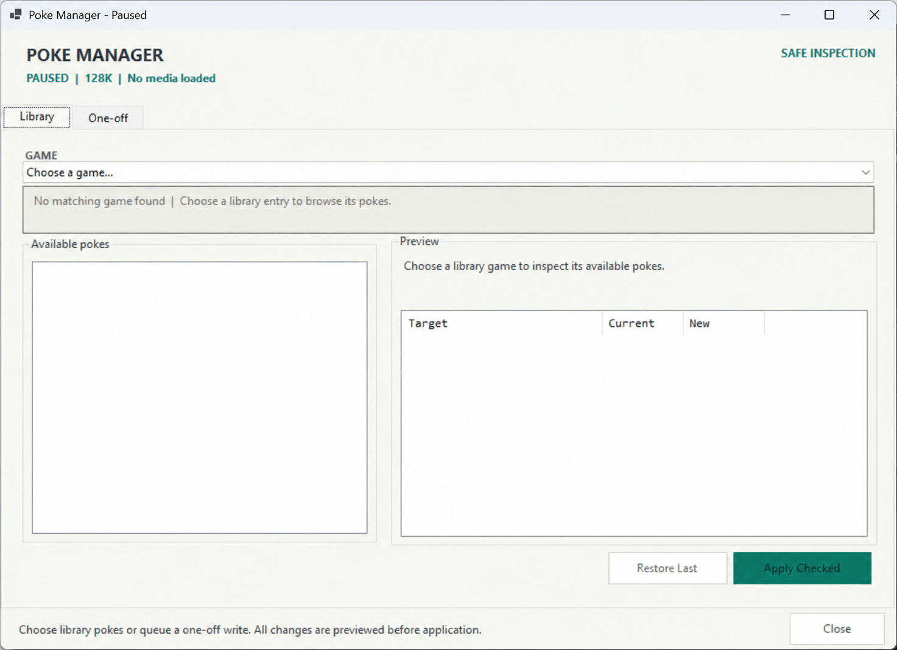

# Spectrum 128K Emulator

## User Guide

**Windows edition**  
**Covers:** 48K and 128K operation, snapshots, tape images, Quick State, controllers, pokes, and debugging


This manual describes the emulator as it operates today. It begins with normal loading and play, then introduces the controller, Poke Manager, and debugger tools. Development status and architecture remain in [`README.md`](../README.md); tested software and reached checkpoints are recorded in [`VERIFIED_GAMES.md`](VERIFIED_GAMES.md).

> **Documentation note:** Screens and controls shown here are captured from the current Windows build. Planned features are identified explicitly and are not presented as available commands.

## Contents

- [Chapter 1 - Getting Started](#chapter-1---getting-started)
- [Chapter 2 - Main Controls](#chapter-2---main-controls)
- [Chapter 3 - Display And Status](#chapter-3---display-and-status)
- [Chapter 4 - Keyboard Input](#chapter-4---keyboard-input)
- [Chapter 5 - Snapshots And Recordings](#chapter-5---snapshots-and-recordings)
- [Chapter 6 - Tape Images And Multi-load Games](#chapter-6---tape-images-and-multi-load-games)
- [Chapter 7 - Quick State](#chapter-7---quick-state)
- [Chapter 8 - USB Joysticks](#chapter-8---usb-joysticks)
- [Chapter 9 - Poke Manager](#chapter-9---poke-manager)
- [Chapter 10 - Debugger And Disassembler](#chapter-10---debugger-and-disassembler)
- [Chapter 11 - Diagnostics](#chapter-11---diagnostics)
- [Chapter 12 - Troubleshooting](#chapter-12---troubleshooting)
- [Appendix A - Current Limitations](#appendix-a---current-limitations)

# Chapter 1 - Getting Started

The emulator models both the Spectrum 48K and original 128K. The chosen model affects ROM behaviour, memory, timing, sound, and how some games divide their tape content. Select the intended model before mounting a tape.

## Requirements

- Windows with the .NET 10 desktop runtime, or the .NET 10 SDK when running from source.
- The two Spectrum 128K ROM files in the `ROMs` directory:
  - `128-0.rom`
  - `128-1.rom`

From source, start the emulator with:

```text
dotnet run
```

The emulator starts as a Spectrum 128K in `2x Enhanced` display mode and shows the 128K ROM menu.

## First Use

1. Press `F1` to open the built-in control reference.
2. Press `F9`, `F10`, or `F11` depending on the media type you want to load.
3. Use the PC keyboard as the Spectrum keyboard, or configure a USB controller from the right-click menu.
4. Right-click the display whenever you prefer menus to function keys.

# Chapter 2 - Main Controls

The main window keeps permanent controls out of the Spectrum picture. Every command is available through a function key or the right-click menu.

## Built-in Help

Press `F1` to open the quick-reference window. Emulation pauses while it is open. Choose a category on the left, then use `F1`, `Escape`, or **Close** to return.



*Figure 2.1. Help groups display, loading, debugger, keyboard, and joystick controls.*

| Key | Action |
| --- | --- |
| `F1` | Open or close Help; emulation pauses while Help is open |
| `F2` | Show or hide the status overlay |
| `F3` | Reset and switch between 128K and 48K machine modes |
| `F4` | Cycle 1x Native, 2x Enhanced, and 3x Enhanced display sizes |
| `F5` | Stop or resume the mounted tape |
| `F6` | Open or close the paused debugger and disassembler |
| `F7` | Save the current machine to the temporary Quick State slot |
| `F8` | Restore the temporary Quick State |
| `F9` | Load a `.sna` snapshot |
| `F10` | Load a `.z80` snapshot or play an `.rzx` recording |
| `F11` | Mount a `.tap` or `.tzx` tape image |
| `Shift+F11` | Replace the mounted tape while preserving the running machine |
| `F12` | Write a machine diagnostic dump |
| Right-click | Open the complete context menu |

The context menu presents function-key actions in order, followed by joystick options and the Poke Manager. Unavailable commands, such as restoring before a Quick State exists, are disabled.



*Figure 2.2. The complete menu mirrors the function-key order and keeps unavailable actions visible but disabled.*

# Chapter 3 - Display And Status

## Display Size

`F4` cycles these fixed output sizes:

- **1x Native:** `320x240`
- **2x Enhanced:** `640x480`
- **3x Enhanced:** `960x720`

The enhanced modes use pixel-art scaling rather than smoothing the image as an ordinary photograph.

## Status Overlay

Press `F2` to show or hide bottom-left diagnostics including frame rate, frame/model information, tape state, and display mode. This is intended for diagnosis and can remain hidden during normal play.

## Window Title

When media is loaded, its filename appears in the window title. Tape transport state is deliberately kept in the on-screen badge and optional status overlay rather than permanently expanding the title.

## Tape Badge

Tape state changes appear at the top left of the emulated display:

- Full status text is shown for approximately three seconds.
- While tape is running, the display then reduces to a compact play icon.
- Paused, stopped, or ended indications disappear after approximately five seconds.
- Replacing tape media with a snapshot or recording clears the old tape indication immediately.

# Chapter 4 - Keyboard Input

The Windows frontend captures physical key messages before normal menu/control preprocessing and passes them to the emulated keyboard matrix on the emulation thread.

## Direct Keys

- Letters and numbers map to the corresponding Spectrum keys.
- `Enter` and `Space` map directly.
- PC `Shift` maps to Spectrum **CAPS SHIFT**.
- PC `Ctrl` or `Alt` maps to Spectrum **SYMBOL SHIFT**.
- Common punctuation is translated into the appropriate Spectrum SYMBOL SHIFT chord.
- Arrow keys generate the Spectrum cursor-key chords.

Shared Spectrum chords track each physical host key independently. Releasing one PC key will not incorrectly release a Spectrum modifier still owned by another held key.

## Focus

Click the emulator display if a game is not receiving input after another dialog was used. Help, file choosers, Poke Manager, and the debugger deliberately pause or redirect keyboard focus while open.

# Chapter 5 - Snapshots And Recordings

Snapshots resume a stored machine state immediately; RZX recordings add deterministic recorded input. Loading any of these replaces the active program and clears old tape transport and badge state.

Loading new media resets tape transport and any tape badge left by the previous title.

## SNA Snapshots

Press `F9` and choose a `.sna` file.

Supported SNA state includes:

- Standard 48K snapshots.
- 128K snapshots with all RAM banks, paging state, and explicit program counter.
- The supported duplicate-current-page 128K layout.

TR-DOS snapshots are rejected because the emulator does not provide a TR-DOS ROM. A 48K-format snapshot may run on either the selected 48K or 128K machine model.

## Z80 Snapshots

Press `F10` and choose a `.z80` file.

The emulator supports Z80 v1, v2, and v3 snapshots, including applicable 128K paging and RAM-bank state.

## RZX Recordings

Press `F10` and choose an `.rzx` recording. Recorded input has priority over live joystick port input so replay remains deterministic. Quick State also preserves the replay position.

# Chapter 6 - Tape Images And Multi-load Games

Tape images reproduce a loading process rather than a finished machine state. The emulator accelerates only the loader paths it can represent safely and falls back to ROM/pulse loading for ambiguous or protected sequences.

Press `F11` and choose a `.tap` or `.tzx` image.

For a multi-side release, wait until the game asks for the other side and press
`Shift+F11`. Choose the next tape image to replace the mounted tape without
resetting CPU, RAM, paging, or the running game. The same action is available
from the right-click menu and is disabled until a tape is mounted.

## Automatic Loading

The emulator selects a loading strategy from the tape structure:

- Safe, understood bootstrap programs may be accelerated.
- Unsupported or ambiguous loader control flow falls back to the real Spectrum ROM path.
- Protected and custom loaders can continue from exact pulse/EAR state.
- Multi-load games may pause and resume between sections.

This selection is generic. It does not depend on game filenames or title-specific hashes.

## 128K And 48K Behavior

Many games use different loading behavior by model:

- A 128K version may preload more content.
- A 48K version may stop after loading the current level and ask for the tape later.
- Some games marketed for both models still use a multi-load sequence on 128K.

Use `F3` before mounting the tape when you want to test the other machine model. Switching model resets the machine.

## Manual Tape Control

Use `F5` to stop or resume the mounted tape without ejecting it. Resume only when the game asks for more tape input.

The emulator also handles supported TZX pauses, stop markers, tape end, and detected loader handoffs automatically. A stopped tape remains mounted and can be resumed.

## If A Multi-load Fails

1. Confirm the correct 48K/128K model was selected before mounting.
2. Wait for the game to request the next section.
3. If the game requests another tape side, press `Shift+F11` and select it.
4. Press `F5` once to resume if the mounted tape did not start automatically.
5. If the game immediately errors, do not repeatedly toggle transport; record the displayed error and media filename for diagnosis.

# Chapter 7 - Quick State

Quick State is one temporary, in-memory save slot.

- Press `F7` to capture it.
- Press `F8` to restore it.
- `F8` remains unavailable until a state has been saved.
- Saving again replaces the previous slot.
- The slot is discarded when the emulator exits.

Quick State restores CPU state, all RAM banks, paging, ULA/video state, audio generation state, current media name, tape pulse/EAR and loader-continuation position, and RZX replay position. It can survive loading different media during the same emulator session and then return to the captured state.

Live host details such as a controller connection are not stored as emulated machine state. Audio and input adapters are cleaned up when a state is restored.

# Chapter 8 - USB Joysticks

Right-click the display and open **Joystick**. Controller 1 and Controller 2
have separate status and selection submenus. Choose **Configure both
controllers...** for the full mapping window.

## Device Selection

- **Off:** disconnect that controller channel from the emulated machine.
- **Automatic:** use the first available USB controller not claimed by the other channel.
- **Named device:** use only that specific connected controller.

Automatic channels claim different devices. A named device is not silently
replaced if it disappears, and unavailable input becomes neutral so no direction
or Fire remains stuck.

## Spectrum Interface

Choose **Joystick > Configure both controllers...** and select the interface
expected by the game for each enabled channel:



*Figure 8.1. Two independent mappings support original dual-joystick software; each live preview verifies the selected interface and controls before **Save mappings** is used.*

- **Kempston:** active-high directions and Fire through port `1FH`.
- **Cursor:** directions and Fire through Spectrum keys `5`, `8`, `6`, `7`, and `0`.
- **Sinclair 1:** keys `1-5` (physical Interface II socket 2).
- **Sinclair 2:** keys `6-0` (physical Interface II socket 1).

The socket numbers on the original Interface II hardware run opposite to the
Sinclair 1/2 labels commonly presented by games. The configuration dialog shows
both names so that the selected option matches the game menu without hiding the
historical wiring.

For two-player Interface II software, enable both channels and assign one to
Sinclair 1 and the other to Sinclair 2. Two enabled channels cannot claim the
same USB device or Spectrum interface; the dialog explains the conflict rather
than saving an ambiguous setup.

The game must be configured for the same interface. For example, choosing Sinclair in the emulator will not operate a game menu configured for Kempston.

## Mapping

The configuration dialog lets you choose:

- Horizontal axis.
- Vertical axis.
- Optional D-pad/hat.
- Fire button.
- Axis dead zone.

Move each controller and press Fire while the dialog is open. Its live preview
shows the interface, direction, and Fire state. **Save mappings** stores both
channels for the current Windows user. Existing single-controller settings are
retained as Controller 1 and Controller 2 starts disabled.

The default mapping is axes 1/2 as displayed by the UI, hat 1 where available, button 1, and a 25% dead zone. Device hardware may expose different counts or ordering, so use the preview rather than relying on labels alone.

# Chapter 9 - Poke Manager

Right-click the display and choose **Poke Manager...**. Emulation pauses while the manager is open.



*Figure 9.1. The Library tab combines matching, selection, preview, guarded application, and restoration in one paused workflow.*

## Library Tab

The shipped library is loaded from `Pokes/pokes.json`.

1. Load the game or snapshot first.
2. Open Poke Manager.
3. Review the match status.
4. Tick one or more named pokes.
5. Review current and replacement bytes in **Preview**.
6. Select **Apply Checked**.

An exact SHA-256 match is authoritative for that media image. A filename alias is only a discovery suggestion and is labelled accordingly. If nothing matches, the manager stays on **Choose a game...** rather than selecting an unrelated title.

## One-off Tab

Use this for a temporary manual write:

1. Choose **Mapped 64K** or **Physical RAM bank**.
2. For a physical write, choose the RAM bank.
3. Enter the address and byte value in hexadecimal or decimal.
4. Choose **Add Write**.
5. Review current and new values.
6. Choose **Apply Pending**.

Mapped addresses refer to the CPU-visible 64K address space. Physical-bank addresses refer to offsets in a selected 16K RAM bank. Do not substitute one for the other.

## Restore Last

The manager keeps a session-local restoration stack. **Restore Last** restores the previous bytes only if the running program has not changed an applied byte since the poke. Refusing restoration is intentional protection against overwriting newer game state.

The initial library provides one-time writes. Continuously frozen values and conditional trainers are not currently supported.

# Chapter 10 - Debugger And Disassembler

Press `F6` to open the debugger. The emulator pauses safely at an instruction boundary and presents an immutable capture.


*Figure 10.1. The debugger combines execution controls, paging, grouped CPU state, disassembly, references, memory inspection, and breakpoints.*

## Workspace

The debugger includes:

- Mapped 64K, both ROM banks, and all eight physical RAM banks.
- Current paging map and active display bank.
- Main and alternate registers.
- Individual flags, interrupt state, HALT state, and T-states.
- Four stack words and the instruction at `PC`.
- Disassembly listing, targets, breakpoints, cross-references, and memory inspection.

Values changed since the previous stopped capture are highlighted in yellow. Active flags use a soft teal highlight.

## Execution

| Control | Shortcut | Action |
| --- | --- | --- |
| Run / Pause | `F5` | Run or request a pause at the next instruction boundary |
| Step Over | `F10` | Execute a call as one operation; otherwise step one instruction |
| Step Into | `F11` | Execute one instruction and stop |
| Step Out | `Shift+F11` | Run to the return address currently on the stack |
| Run to Cursor | `Ctrl+F10` | Run to the selected mapped instruction without adding a breakpoint |
| Toggle Breakpoint | `F9` | Add or remove a breakpoint at the selected mapped instruction |

The listing remains frozen while execution runs. It refreshes only after execution stops safely.

## Navigation

- Arrow keys move through listing rows.
- `Enter` follows a direct branch or call target.
- `Alt+Left` and `Alt+Right` move through address history.
- `Ctrl+G` focuses address entry.
- `Ctrl+P` returns to the captured program counter.
- `Ctrl+R` refreshes the capture while paused.
- Clicking PC or a stack value navigates the mapped listing.
- Clicking other address-valued registers opens the Memory tab.

## Search

Use `Ctrl+F` to focus search and `F3` to find the next match. Search can locate an address, byte sequence, or mnemonic text in the current capture and selected memory view.

## Memory Views

The **Memory View** selector distinguishes:

- Mapped 64K logical addresses.
- Individual ROM banks.
- Individual 16K RAM banks.

The four paging blocks show which ROM/RAM occupies `0000-3FFF`, `4000-7FFF`, `8000-BFFF`, and `C000-FFFF`. The display-bank label identifies the RAM bank currently scanned by the ULA.

## Memory Inspector

Open the **Memory** tab to inspect hexadecimal and ASCII bytes without changing the disassembly view. Sources include mapped memory and physical banks. Register, stack, listing, and direct-reference navigation can take you to relevant bytes.

## Labels And Classification

Use `Ctrl+L` or right-click the listing to:

- Add or edit a bank-qualified label.
- Mark selected ranges as code, data, or unknown.
- Inspect memory.
- Manage symbols.

Labels and classifications are scoped by media/model and persist between sessions. Confirmed data is shown/exported as `DB`, excluded from mnemonic search, and not recursively interpreted as code. Following an unlabeled direct branch or call can create an automatic label.

## Cross-references

The **References** tab lists conservative incoming and outgoing references for direct calls/jumps and absolute data reads/writes. Indirect accesses and arbitrary bytes are deliberately not guessed as code.

## Copy And Export

- `Ctrl+C` copies selected rows with capture metadata.
- `Ctrl+Shift+C` copies every displayed row.
- `Ctrl+E` exports the selected view: 64K for mapped memory or 16K for a physical bank.

# Chapter 11 - Diagnostics

Press `F12` to write a machine diagnostic dump. Use this when reporting a reproducible emulation problem; note the game/media filename, machine model, point reached, and visible error.

The optional `F2` overlay is useful for checking model, display, frame, and tape state before collecting a dump.

# Chapter 12 - Troubleshooting

## A Tape Mounts But Nothing Appears

- Some protected loaders remain black for a while during real-time pulse playback.
- Confirm the tape badge says it is playing.
- Confirm the correct machine model was selected before mounting.
- Avoid pressing keys unless the loader or game requests one.

## A Game Requests More Tape

Press `F5` once. If loading fails immediately, capture the exact error rather than repeatedly stopping and starting the tape.

## A Game Loads With The Wrong Controls

- Check the game’s own selected control scheme.
- Match it to Kempston, Cursor, or Interface II in Joystick Configuration.
- Use the live preview to confirm directions and Fire.

## Keys Do Not Reach The Game

- Close or move focus away from Help, Poke Manager, debugger, or a file chooser.
- Click the emulator display.
- Confirm a joystick interface is not being mistaken for keyboard controls in the game menu.

## Sound Is Missing Or Distorted

- Verify whether the title is running in 48K or 128K mode; 128K AY music may not exist in a 48K version.
- Let accelerated tape loading finish before judging audio.
- Capture the media name, model, and exact point where sound differs.

## A Snapshot Is Rejected

- Confirm its extension matches the selected loader.
- Non-standard/truncated SNA files and unsupported TR-DOS state are rejected rather than guessed.
- SZX is not yet supported.

## Pokes Are Not Automatically Matched

- The loaded file may differ from the library’s exact checksum.
- A filename suggestion is not proof that addresses match.
- Use a validated library entry or enter a one-off poke only when you know the correct address space and value.

# Appendix A - Current Limitations

- SZX snapshots are planned but not implemented.
- An on-screen 48K/128K keyboard is planned but not implemented.
- Kempston Mouse and AMX Mouse are planned but not implemented.
- Broader protected/custom TZX compatibility remains ongoing.
- The Poke library uses one-time writes rather than frozen/conditional trainers.
- Palette selection and CRT/composite-inspired presentation are planned; the current display uses the idealised digital palette.
- The current desktop frontend is Windows-only, although the emulator core remains platform-neutral.

For media known to work, partially work, or fail, consult [`VERIFIED_GAMES.md`](VERIFIED_GAMES.md).

